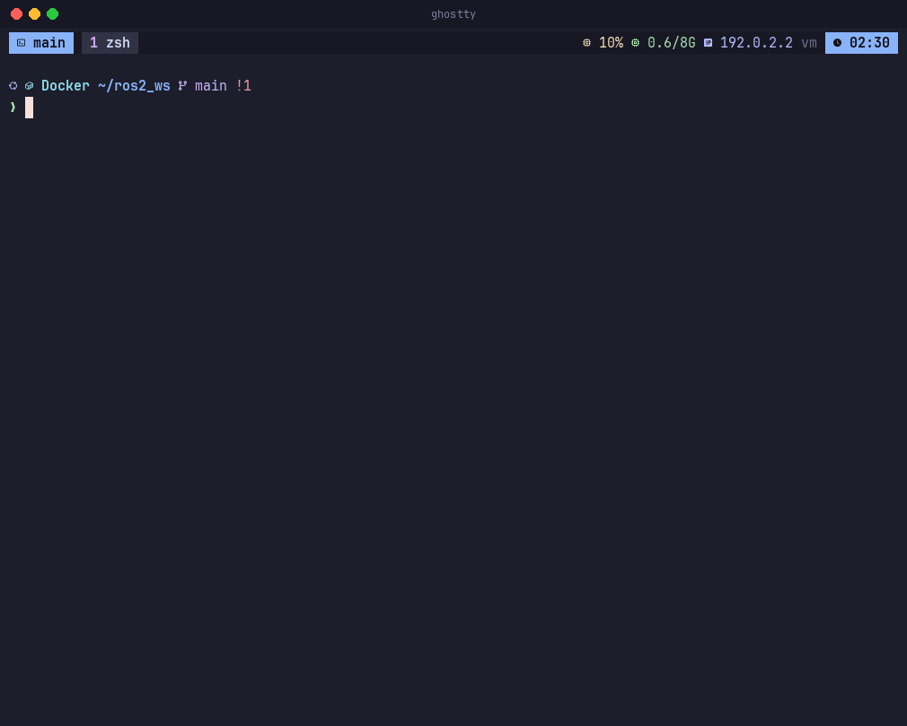
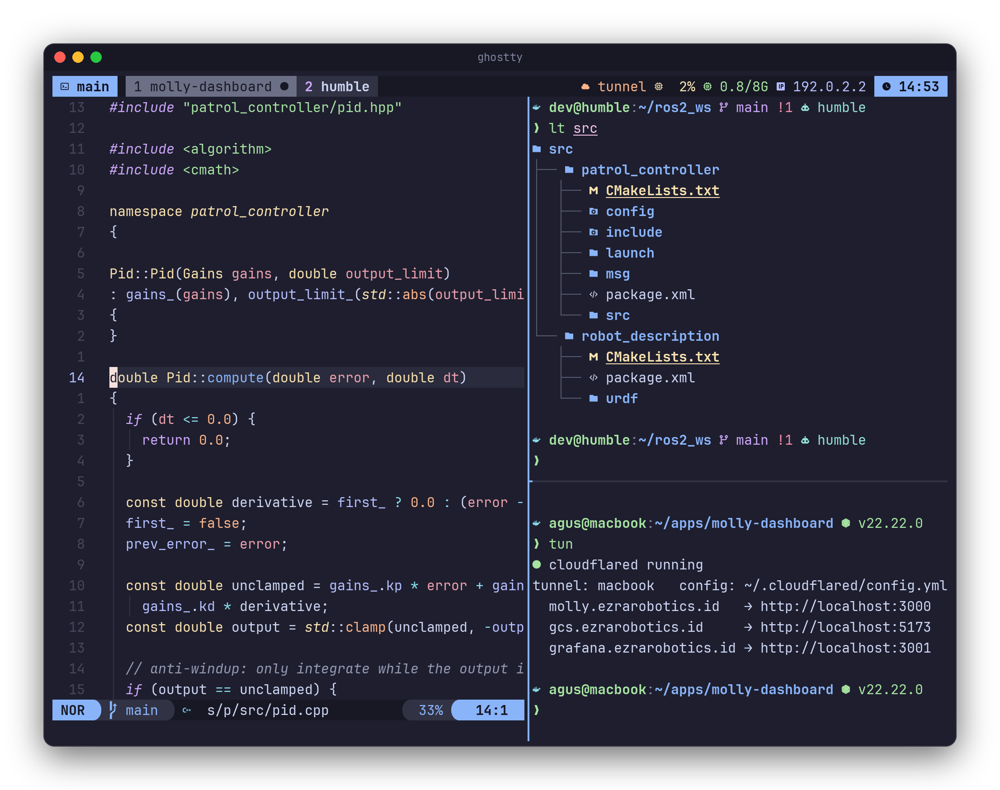
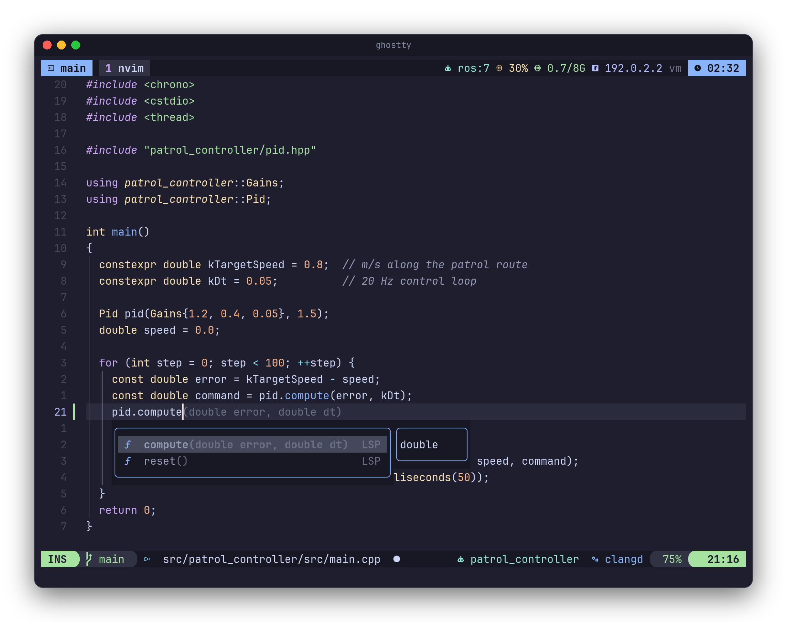
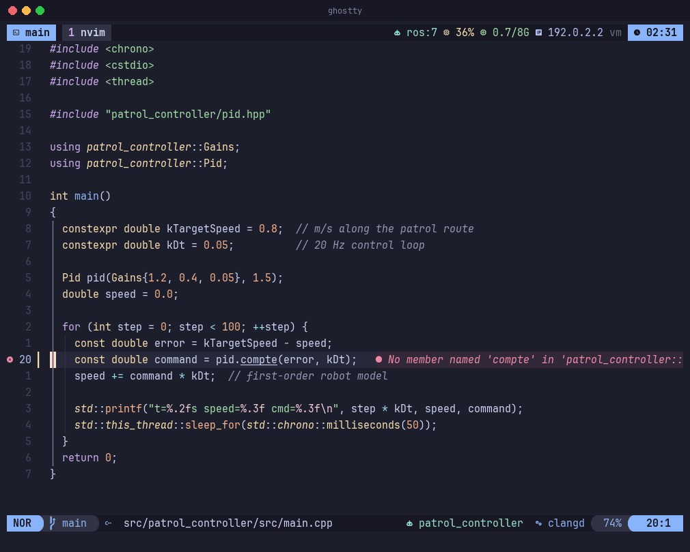

<div align="center">


# dotfiles

**My daily macOS terminal: Ghostty, tmux, zsh and Neovim, set up for ROS 2, C++, web and Flutter
work. The same config runs inside Docker dev containers and on robots over SSH.**

[](https://github.com/agus-darmawan/dotfiles/actions/workflows/ci.yml)


[](LICENSE)

[Install](#install) · [Features](#features) · [Keys](#keys) · [Documentation](#documentation) ·
[Develop](#develop)



</div>

---

One repository for the whole terminal: the emulator, the multiplexer, the shell and the editor share
one theme and one font, and know about each other (`Ctrl-h/j/k/l` moves between tmux panes and
Neovim splits, yanks reach the macOS clipboard from inside containers and SSH sessions).

## Install

```bash
git clone https://github.com/agus-darmawan/dotfiles ~/dotfiles
cd ~/dotfiles && ./install.sh
```

The installer runs the [`Brewfile`](Brewfile), backs up existing configs to `~/.dotfiles-backup/`,
links everything with GNU Stow, prepares `~/.ssh/config` and `~/.ssh/config.d/robots`, and installs
the tmux, zsh and Neovim plugins. Then open **Ghostty** and type `t`. Check the result with
`~/dotfiles/tests/smoke.sh`.

Inside a dev container, a Jetson or a robot: `~/dotfiles/container/install.sh`
([guide](docs/CONTAINER.md)).

## Features

**Terminal and tmux**
- Ghostty with Catppuccin Mocha, JetBrainsMono Nerd Font and a drop-down quick terminal on `` cmd+` ``.
- Prefer iTerm2? `install.sh` adds a matching profile: Preferences → Profiles → **dotfiles (Catppuccin Mocha)** → *Set as Default*.
- The VS Code terminal uses the same shell; add the font and title settings from [vscode/](vscode/README.md).
- tmux status bar on top: session, windows, Cloudflare Tunnel, running containers, CPU, RAM, IP, battery, time.
- Popups for lazygit, lazydocker and btop; fuzzy pickers for projects, sessions, SSH hosts and containers.
- `dev <host>` opens a session on a container or robot over SSH (windows code, build, run).
  `F12` hands every key to a tmux running on the robot.



**Neovim**
- Own modular config, every language in one registry file: LSP, formatter, linter and parser.
- C++ (clangd), Python, CMake, ROS launch/URDF/xacro XML, `.msg`/`.srv`, TypeScript and Next.js,
  Dart, Docker, Bash, Lua, Markdown.
- 20 plugins: blink.cmp completion, snacks.nvim pickers and explorer, which-key, gitsigns, lazygit.



**ROS 2**
- `Space rb` builds the package you are editing with colcon: errors land in the quickfix list,
  `compile_commands.json` is merged and clangd restarts.
- Pickers for topics, nodes, services, launch files and executables; `ros2 interface show` for the
  message under the cursor.
- Shell helpers inside containers and on robots (never on the Mac), for ROS 2 (colcon) and ROS 1 (catkin):
  `ros`, `rosdomain`/`rosmaster`, `cb`/`cbp`/`ct`, `rtopic`, `rnode`.



**Containers and robots**
- `dsh` / `C-a d` opens the best shell in any running container; `dev <host>` opens a full session in it over SSH.
- SSH multiplexing: extra panes on the same robot connect instantly; `sall go2 lite3` types into
  several robots at once.
- `NVIM_OFFLINE=1` on machines without internet skips every automatic download.

## Keys

tmux prefix `Ctrl-a` · Neovim leader `Space`

| Keys | Action |
|---|---|
| `t` | attach or create the tmux session `main` |
| `C-a \|` · `C-a -` | split right · split down |
| `C-h/j/k/l` | move between tmux panes and Neovim splits |
| `C-a f` · `C-a s` | open a project · switch session |
| `C-a S` · `C-a d` | SSH to a host · shell into a container |
| `C-a g` · `C-a b` | lazygit · btop |
| `Space Space` · `Space /` | find files · grep |
| `gd` · `K` · `Space ca` | definition · hover · code action |
| `Space rb` · `Space rt` | colcon build this package · ROS topics |
| `Space gg` | lazygit |

Every key: [docs/KEYMAPS.md](docs/KEYMAPS.md)

## Documentation

| For | Document |
|---|---|
| Learning the setup step by step (Bahasa Indonesia) | [TUTORIAL.md](docs/TUTORIAL.md) |
| All shortcuts: Ghostty, tmux, Neovim, ROS, git | [KEYMAPS.md](docs/KEYMAPS.md) |
| Docker dev containers, Jetson, robots | [CONTAINER.md](docs/CONTAINER.md) |

Personal overrides stay out of git: `~/.zshrc.local`, `~/.config/tmux/tmux.local.conf`,
`~/.config/git/config.local`, `~/.ssh/config.d/`.

## Develop

```bash
~/dotfiles/tests/smoke.sh     # links, tmux, zsh helpers, every Neovim plugin
```

The `ci` workflow runs on every push: ShellCheck, StyLua and syntax checks; a full `install.sh` on
macOS followed by the smoke test; and `container/install.sh` inside the `ros:humble` and `ros:jazzy`
images, where Neovim builds a real ament package with colcon.

Update with `git pull && ./install.sh --no-brew`; remove the links with `./install.sh --unlink`.

Released under the [MIT License](LICENSE).
